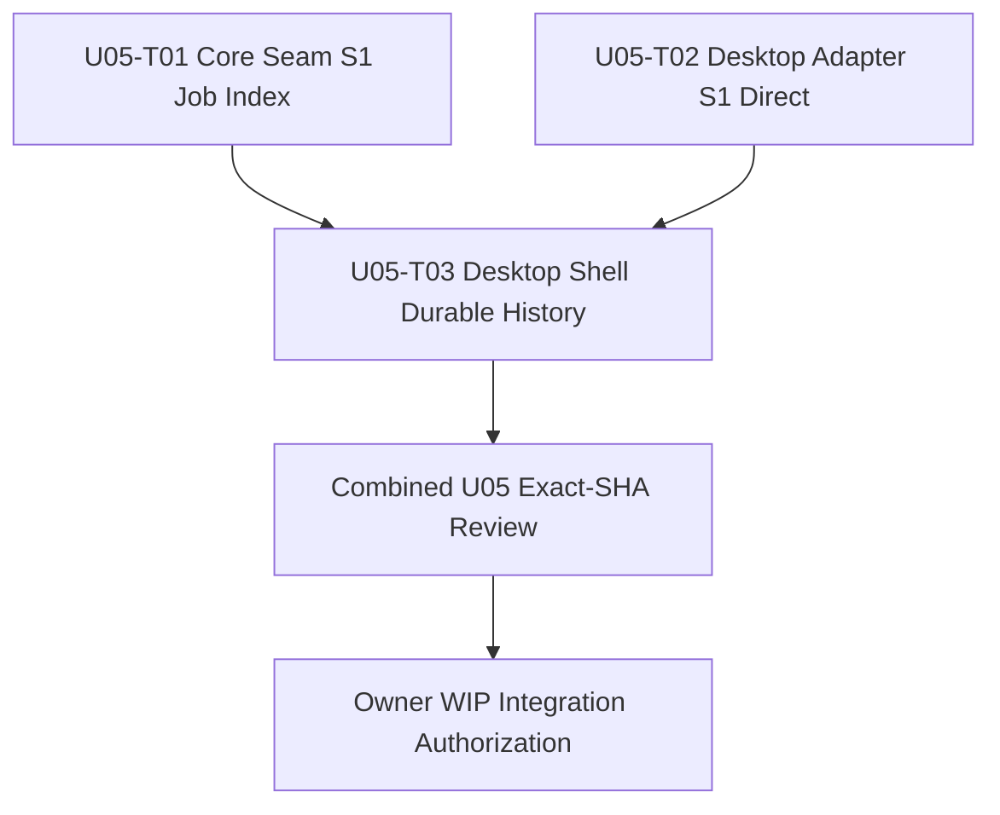

# U05 Desktop S1 — Implementation DAG R0

> STATE: OWNER_APPROVED / TASK_DAG_FROZEN / SOURCE_NOT_DISPATCHED
> Parent: #310
> Freeze record: [U05_PRODUCT_L2_FREEZE_RECORD_R0.md](./U05_PRODUCT_L2_FREEZE_RECORD_R0.md)
> Approved Product HEAD: `2ca7b4f6d503667d41ae15458ef2e4ef2eb143e3`
> Product blob: `d4edc5d477c14cdb30cc29b31c15a98237232ae9`
> L2 blob: `2b984b859acdba4e5cc9b85813fbbb4c29eea288`
> Initial source WIP base: `ea0eecd65a1c317fc43e9eb20356c5b5f9d6dbcd` / tree `870657c54eecae9721a6b06221828a6bdfdfbb0d`

## 1. DAG

T01 and T02 are independent and may run in parallel. T03 is strictly downstream of both. The three implementation writers have disjoint path sets. Combined verification/review and WIP integration are separate gates, not extra source writers.

## 2. Task matrix and exact write sets

| Task | Issue | Depends on | Exclusive write set |
|---|---:|---|---|
| U05-T01 Core Seam read-only index query | #351 | — | `packages/core-seam/src/envelope.ts`; `packages/core-seam/src/server.ts`; `packages/core-seam/test/envelope-wire-compatibility.test.ts`; `packages/core-seam/test/projection-read-side.test.ts`; new `packages/core-seam/test/s1-job-index.test.ts` |
| U05-T02 Desktop adapter S1 command mapping | #352 | — | `apps/desktop/src/adapter.ts`; `apps/desktop/src/commands.ts`; `apps/desktop/src/manager-documents.ts`; `apps/desktop/test/core-authority.test.ts`; `apps/desktop/test/manager-documents.test.ts`; new `apps/desktop/test/s1-direct-acquisition.test.ts` |
| U05-T03 Desktop shell durable history | #353 | #351, #352 | `apps/desktop-shell/src/main/manager.ts`; `apps/desktop-shell/src/main/shell-contract.ts`; `apps/desktop-shell/src/main/ipc.ts`; `apps/desktop-shell/src/main/validators.ts`; `apps/desktop-shell/src/main/main.ts`; `apps/desktop-shell/src/preload/preload.ts`; `apps/desktop-shell/src/renderer/manager-state.ts`; `apps/desktop-shell/src/renderer/renderer-main.ts`; `apps/desktop-shell/src/renderer/index.html`; `apps/desktop-shell/src/renderer/styles.css`; `apps/desktop-shell/test/manager.test.ts`; `apps/desktop-shell/test/manager-view.test.ts`; `apps/desktop-shell/test/security-invariants.test.ts`; `apps/desktop-shell/test/validators.test.ts` |

## 3. Writer and integration boundaries

- T01 is the only writer of Core Seam envelope/query/server behavior and its tests. It does not edit `state.ts`, `peer.ts`, `projection.ts`, Core Runtime, or package manifests.
- T02 is the only writer of the Desktop adapter, Desktop command-envelope helpers, and Desktop projection-to-manager row mapping/tests. It does not edit CLI, Core Seam, Core Runtime or shell IPC/renderer.
- T03 is the only writer of the Desktop shell manager, IPC/preload bridge, renderer and corresponding shell tests. It does not edit `apps/desktop/**`, Core Seam or Core Runtime.
- No task edits package manifests, root lockfile, CI definitions, vendored SDK or Host implementation.
- A04 remains the sole Core Runtime composition / App-Host manifest / root lockfile integration writer. U05 does not take any A04 path.
- T01/T02 Task Packs are initially bound to WIP `ea0eecd...`; if WIP moves before claim, each task must independently rebind to current HEAD/tree.
- T03's write set is frozen, but its initial base is provisional only. Before any claim it MUST rebind to the WIP HEAD containing reviewed and Owner-integrated T01/T02. No T03 source mutation is allowed on the initial base.

## 4. Acceptance gates

1. Product/L2 exact blobs match the freeze record.
2. Each Task Pack is independently reviewed and exact-base current.
3. Each Local Builder publishes its own accepted ADS `DISPATCH_CLAIMED` before source mutation.
4. Node 24 syntax and changed-file Prettier complete before CI.
5. Focused tests, typecheck, aggregate `pnpm run ci:verify`, and local Docker Woodpecker pass at the exact candidate SHA.
6. Independent Exact-SHA review returns P0=0/P1=0 and records P2 separately.
7. Combined U05 candidate passes the end-to-end sequence: preview/confirm, S1 command acceptance, terminal projection refresh, durable same-user history, restart/reopen, cross-user denial and truthful 200-item truncation.
8. Separate Owner authorization is obtained before WIP integration.

## 5. Stop conditions

- Any need to change frozen Product/L2, S1 command semantics, K/Host/Core ownership or widen to S2–S6.
- Any need to add a second journal/index store, transfer engine, downloader, scheduler, K or terminal projector.
- Any request to add per-download outputRoot, folder picker, guessed path, reveal or unprojected progress/ETA.
- Any write outside the task's exact write set, stale base, missing Builder Claim, overlap or unreviewed dependency.
- Any request for main/version/release/deployment or real external download/Native Host/registry side effects.