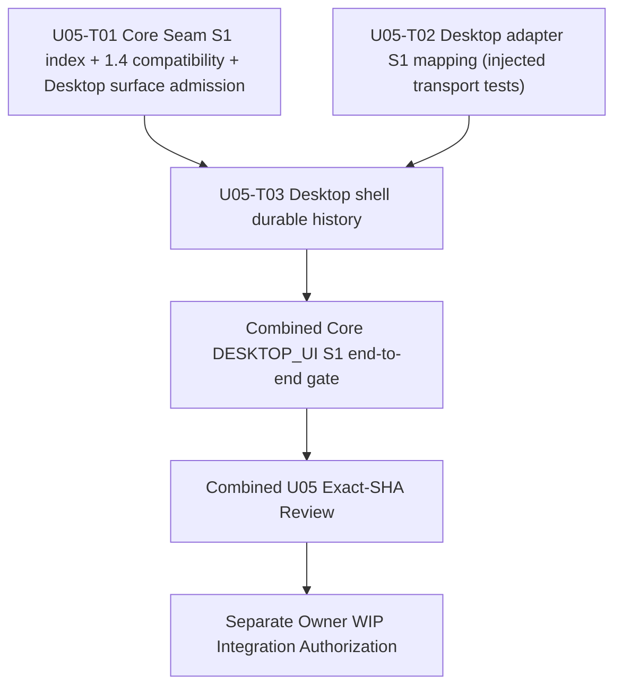

# U05 Desktop S1 — Implementation DAG R1

> STATE: OWNER_APPROVED / INDEPENDENT_R1_TASK_PACK_REVIEW_REQUIRED / SOURCE_DISPATCH_PENDING
> Parent: #310
> Amendment authorization: #354 comment 6623288615
> R0 history: [U05_DESKTOP_S1_IMPLEMENTATION_DAG_R0.md](./U05_DESKTOP_S1_IMPLEMENTATION_DAG_R0.md)
> Freeze record: [U05_PRODUCT_L2_FREEZE_RECORD_R0.md](./U05_PRODUCT_L2_FREEZE_RECORD_R0.md)
> Approved Product blob (immutable): `d4edc5d477c14cdb30cc29b31c15a98237232ae9`
> Approved L2 blob (immutable): `2b984b859acdba4e5cc9b85813fbbb4c29eea288`
> Initial source WIP base: `ea0eecd65a1c317fc43e9eb20356c5b5f9d6dbcd` / tree `870657c54eecae9721a6b06221828a6bdfdfbb0d`

## 1. Amendment purpose

R0 exposed two execution-contract defects without changing the approved Product/L2 capability:
- T01's mandated Core Seam schema 1.4.0 update left four existing tests outside its five-path write set still asserting 1.3.0.
- T02 correctly preserves `DESKTOP_UI`, but the existing Core S1 command gate admits only `CLI`. Rewriting Desktop's peer as CLI is forbidden.

R1 changes only the implementation DAG and Task Packs. Product/L2 blobs remain immutable.

## 2. DAG

T01 and T02 remain independent, disjoint writers and may execute in parallel. T01 is the sole Core Seam writer. T02 is Desktop-only and must not claim that a mock transport proves Core admission. T03 remains strictly downstream of both.

## 3. Task matrix and exact exclusive write sets

| Task | Issue | Depends on | Exclusive write set |
|---|---:|---|---|
| U05-T01 Core Seam index, schema compatibility and S1 surface admission | #351 | — | `packages/core-seam/src/envelope.ts`; `packages/core-seam/src/server.ts`; `packages/core-seam/test/envelope-wire-compatibility.test.ts`; `packages/core-seam/test/projection-read-side.test.ts`; new `packages/core-seam/test/s1-job-index.test.ts`; `packages/core-seam/test/s3-closed-wire-admission.test.ts`; `packages/core-seam/test/s4-closed-wire-admission.test.ts`; `packages/core-seam/test/s4-seam12-payload.test.ts`; `packages/core-seam/test/verified-session.test.ts`; new `packages/core-seam/test/s1-command-surface.test.ts` |
| U05-T02 Desktop adapter S1 command mapping | #352 | — | `apps/desktop/src/adapter.ts`; `apps/desktop/src/commands.ts`; `apps/desktop/src/manager-documents.ts`; `apps/desktop/test/core-authority.test.ts`; `apps/desktop/test/manager-documents.test.ts`; `apps/desktop/test/s1-direct-acquisition.test.ts` |
| U05-T03 Desktop shell durable history | #353 | #351, #352 | `apps/desktop-shell/src/main/manager.ts`; `apps/desktop-shell/src/main/shell-contract.ts`; `apps/desktop-shell/src/main/ipc.ts`; `apps/desktop-shell/src/main/validators.ts`; `apps/desktop-shell/src/main/main.ts`; `apps/desktop-shell/src/preload/preload.ts`; `apps/desktop-shell/src/renderer/manager-state.ts`; `apps/desktop-shell/src/renderer/renderer-main.ts`; `apps/desktop-shell/src/renderer/index.html`; `apps/desktop-shell/src/renderer/styles.css`; `apps/desktop-shell/test/manager.test.ts`; `apps/desktop-shell/test/manager-view.test.ts`; `apps/desktop-shell/test/security-invariants.test.ts`; `apps/desktop-shell/test/validators.test.ts` |

The T01 ten-path set is exactly the original five paths plus four existing compatibility-test paths and one new command-surface test. T02 remains exactly six paths. T03 remains exactly fourteen paths. No path is shared by writers.

## 4. Required R1 behavior

### T01 — sole Core Seam writer

1. Keep `LIST_S1_JOB_PROJECTIONS` closed, read-only, same-install/same-user scoped and derived only from the accepted-command journal plus `projectAggregate`.
2. Bump `CORE_SEAM_SCHEMA_VERSION` to 1.4.0 while preserving existing schema 1.3 command and `READ_PROJECTION` compatibility.
3. Update only stale expected-current-version assertions in the four newly admitted compatibility tests to 1.4.0. Preserve all historical 1.0/1.1/1.2 compatibility assertions and all non-version security/behavior assertions.
4. For the existing `EXECUTE_S1_DIRECT_ACQUISITION` command, admit exactly `CLI` and `DESKTOP_UI`. Every other defined peer surface remains rejected.
5. Preserve the existing per-frame `authorizePeer` path and all accepted-contract/aggregate/Lineage, redirect-host, budget, digest, request identity, runtime and fail-closed checks. Do not rewrite or spoof Desktop's peer surface.
6. Add positive tests for CLI and DESKTOP_UI and negative tests for every other defined surface. Tests must prove that the per-frame Peer authorization still executes and cannot be bypassed by a surface label.
7. Keep all index query ordering, deduplication, 200-row bound, totalCount/truncated and missing-projection semantics from R0 unchanged.

### T02 — Desktop-only adapter writer

1. Preserve the `DESKTOP_UI` peer surface; never rewrite it to CLI.
2. Preserve preview/confirmation and accepted aggregate binding, canonical identities, URL-host-only redirect default, stable logical request identity and Core-owned projection truth.
3. Use a deterministic injected/mock SeamClient transport for adapter mapping tests, entirely within the six-path write set.
4. Label those tests/results as adapter-unit evidence only. A mock response must not be described as Core acceptance, end-to-end admission or proof of Core security gates.
5. Actual Core admission for DESKTOP_UI is verified only against the combined candidate after T01 is integrated, through T03's end-to-end acceptance.

### T03 — unchanged shell writer

Keep the fourteen-path shell write set and existing functional contract. Rebind its Task Pack to the WIP HEAD/tree containing the independently reviewed and separately Owner-integrated T01 and T02 candidates. Combined end-to-end acceptance must exercise the real Core `DESKTOP_UI` S1 route, durable history, restart/reopen and same-user isolation.

## 5. Dispatch and validation gates

- T01's generation-1 claim is superseded for further mutation. Preserve its existing uncommitted compatible implementation; do not reset or discard it. Before additional source mutation, reconcile it against R1, verify no out-of-scope files are dirty, and publish a fresh accepted generation-2 CAS `DISPATCH_CLAIMED` bound to the R1 Task Pack and exact base.
- T02's generation-1 claim is superseded for further mutation. Its reported worktree was clean; re-read exact base and publish a fresh accepted generation-2 CAS `DISPATCH_CLAIMED` bound to the R1 Task Pack and exact base.
- Both Builders own implementation, repair and local validation. No standalone `LOCAL_VALIDATION` task.
- Node 24 syntax checks and changed-file Prettier must pass before CI.
- Run focused tests, typecheck, aggregate `pnpm run ci:verify`, and local Docker Woodpecker at each exact candidate SHA.
- Each task requires a separate independent Exact-SHA source review. No WIP merge is implied by this DAG amendment.
- T03 cannot be claimed or mutated until T01/T02 are independently reviewed and Owner-integrated; then T03 must be rebound to the combined exact WIP base.

## 6. Boundaries

- No Product/L2 changes; approved blobs above are immutable.
- No changes to A04 paths, package manifests, root lockfile, CLI, Core Runtime, Host, Native Host, registry, main, version/v0.2.1, tags, release or deployment.
- No real external download or physical side effect.
- No WIP integration. A separate Owner authorization must name the exact candidate HEAD/tree before any WIP merge.
