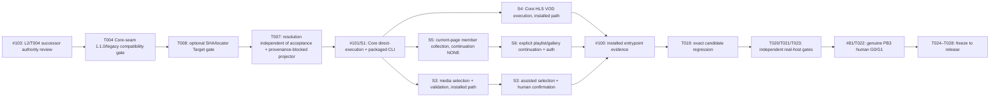

# v0.1.0 Task DAG successor note — executable journeys

**Status:** PROPOSED / same authority review as L2 successor #103.  
**Frozen DAG:** `docs/implementation/v0.1.0/TASK_DAG.md` remains unchanged.  
**Product scope:** S1–S6 all REQUIRED; no Product scope reduction.

## Critical-path correction

T008 direct HTTP, T009 HLS, T011 collection and T016/T017 composed-flow unit-test PASS did not prove that the *packaged* product can execute a user task. The only initially installed execution lane was S2. Therefore completed concern-level tasks T008/T009/T015/T016/T017/T018 remain historical, while **integration closure must gain actual Core execution and a shipped user entrypoint** before T019 candidate validation.

## JIT repair DAG (one concern per PR)

After #103's exact-SHA review and formal S1 successor adoption, **each S3/S4/S5/S6 carrier independently requires its own named L2 successor authority review (fresh exact-SHA) before that carrier's implementation begins**. Only after S3 and S4 public contract decisions are approved may their independent Core implementation concerns run in separate worktrees; S5→S6 still has ordered membership/continuation dependencies. The S1 command is not blanket permission for any other opcode or media/browser workflow. No monolithic multi-surface PR, second Core authority, raw cookie export, or direct-internal-module surrogate for a packaged user event. Dispatched agents must inspect all previous research/test assets, adopt file-level code, and skip new generic demos.

### F06/F07 mandatory repair slices (no false DAG task completion)

- **T004 command compatibility (F06)** is the first contract implementation dependency: source must use `xdownload.core-seam@1.1.0` for `EXECUTE_S1_DIRECT_ACQUISITION`, gate the new opcode on minor >=1, retain the published 1.0 vocabulary, have an old-Core read-only version preflight before any S1 submission and fail closed on incompatible durable journals. Test old CLI/new Core, new CLI/old Core, downgrade and forward replay; retain the existing response vocabulary. An old 1.0 Core accepting a 1.1 request's major number is NOT evidence that it supports the new opcode.
- **T008 validation correction (F07-a)** must allow omitted publisher SHA in normal URL-only S1 while checking every requested locator/redirect edge and real Transfer/Format/Target; no computed hash becomes independent publisher evidence. This is implemented in proposed PR #102 but needs exact-HEAD independent review and installed-host verification.
- **T007 projection correction (F07-b/c)** must separate durable *target resolution* from *validated artifact acceptance*, and add a separately reviewable, provenance-unproven S1 blocker/fulfillment path. Do not fabricate accepted members to force RESOLVED. Test all three normative successor tuples (no digest success, unproven identity, publisher digest mismatch), all five fields, validation evidence and one durable ledger. These are **new bounded implementation concerns** if PR #102 does not already supply the required projector facts; add an isolated T007 PR before S1 Product closure.
- **Requalification (F06/F07)**: exact-SHA source review, clean real installed CLI/Core S1 positive+negative including version mismatch and crash replay, then all affected T019/T020/T021/T023 validation on the **eventual integrated candidate**. A proposed document or green unit tests alone does not qualify the path. No frozen Task DAG rewrite or invented task completion.

## Gate truth

- **T019 = frozen DAG task T019, issue #38**, whose immutable predecessors are **T003, T017, T018** (frozen Task DAG task table). Controller dispatch `xdownload-v0.1.0-T019-successor-validator-004` was **PREEMPTED** in #38 comment 6150187750 while packaged non-S2 journeys remained unavailable; this dispatch identifier is not a frozen task and no new T019 PASS is claimed.
- On any reviewed source merge the candidate exact HEAD/TREE changes, and **T019, T020, T021, T023 must requalify** at the new version subject. Preserve old results, never transfer them.
- #100 must prove actual user input/gesture/CLI invocation → selected scope/provenance → Core accepted work item → durable artifact → canonical terminal for each required S1–S6 path.
- #81 generates hidden independent scenario/oracle/manifests programmatically and freezes before exposure; the **human does not enter SHA or member lists**. Controlled HTTP lab alone cannot qualify real natural-corpus G0.
- No Candidate Freeze while Product S1–S6 or critical journeys are missing; no waiver converting NOT_EXECUTED to PASS.

**Normative decision:** only the reviewed L2 successor and approved concern PRs can advance this DAG note from proposal to adopted. This note is not a 29th Task DAG completion entry, nor a release qualification claim.
