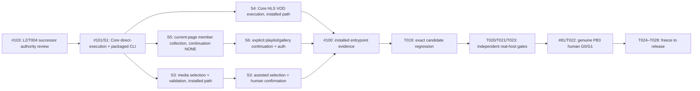

# v0.1.0 Task DAG successor note — executable journeys

**Status:** PROPOSED / same authority review as L2 successor #103.  
**Frozen DAG:** `docs/implementation/v0.1.0/TASK_DAG.md` remains unchanged.  
**Product scope:** S1–S6 all REQUIRED; no Product scope reduction.

## Critical-path correction

T008 direct HTTP, T009 HLS, T011 collection and T016/T017 composed-flow unit-test PASS did not prove that the *packaged* product can execute a user task. The only initially installed execution lane was S2. Therefore completed concern-level tasks T008/T009/T015/T016/T017/T018 remain historical, while **integration closure must gain actual Core execution and a shipped user entrypoint** before T019 candidate validation.

## JIT repair DAG (one concern per PR)

After #103 contract approval, the independent **Core S3** and **Core S4** implementation concerns may run in separate worktrees when their public contracts are fixed, while S5/S6 have ordered continuation constraints. No monolithic multi-surface PR, second Core authority, raw cookie export, or direct-internal-module surrogate for a packaged user event. Dispatched agents must inspect all previous research/test assets, adopt file-level code, and skip new generic demos.

## Gate truth

- T019 predecessor-004 is **PREEMPTED** while packaged non-S2 tasks are unavailable; rerunning the full candidate on a known-incomplete build wastes the gate.
- On any reviewed source merge the candidate exact HEAD/TREE changes, and **T019, T020, T021, T023 must requalify** at the new version subject. Preserve old results, never transfer them.
- #100 must prove actual user input/gesture/CLI invocation → selected scope/provenance → Core accepted work item → durable artifact → canonical terminal for each required S1–S6 path.
- #81 generates hidden independent scenario/oracle/manifests programmatically and freezes before exposure; the **human does not enter SHA or member lists**. Controlled HTTP lab alone cannot qualify real natural-corpus G0.
- No Candidate Freeze while Product S1–S6 or critical journeys are missing; no waiver converting NOT_EXECUTED to PASS.

**Normative decision:** only the reviewed L2 successor and approved concern PRs can advance this DAG note from proposal to adopted. This note is not a 29th Task DAG completion entry, nor a release qualification claim.
