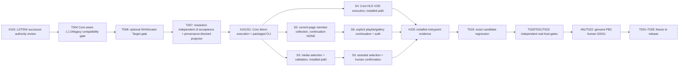

# v0.1.0 Task DAG successor note — executable journeys

**Status:** PROPOSED / same authority review as L2 successor #103.  
**Frozen DAG:** `docs/implementation/v0.1.0/TASK_DAG.md` remains unchanged.  
**Product scope:** S1–S6 all REQUIRED; no Product scope reduction.

## Critical-path correction

T008 direct HTTP, T009 HLS, T011 collection and T016/T017 composed-flow unit-test PASS did not prove that the *packaged* product can execute a user task. The only initially installed execution lane was S2. Therefore completed concern-level tasks T008/T009/T015/T016/T017/T018 remain historical, while **integration closure must gain actual Core execution and a shipped user entrypoint** before T019 candidate validation.

## JIT repair DAG (one concern per PR)

After #103's exact-SHA review and formal S1 successor adoption, **each S3/S4/S5/S6 carrier independently requires its own named L2 successor authority review (fresh exact-SHA) before that carrier's implementation begins**. Only after S3 and S4 public contract decisions are approved may their independent Core implementation concerns run in separate worktrees; S5→S6 still has ordered membership/continuation dependencies. The S1 command is not blanket permission for any other opcode or media/browser workflow. No monolithic multi-surface PR, second Core authority, raw cookie export, or direct-internal-module surrogate for a packaged user event. Dispatched agents must inspect all previous research/test assets, adopt file-level code, and skip new generic demos.

### F06/F07 mandatory repair slices (no false DAG task completion)

- **T004 command compatibility (F06)** is the first contract implementation dependency: source must use `xdownload.core-seam@1.1.0` for `EXECUTE_S1_DIRECT_ACQUISITION`, gate the new opcode on minor >=1, retain the published 1.0 vocabulary, have an old-Core read-only version preflight before any S1 submission and fail closed on incompatible durable journals. Test old CLI/new Core, new CLI/old Core, downgrade and forward replay; retain the existing response vocabulary. An old 1.0 Core accepting a 1.1 request's major number is NOT evidence that it supports the new opcode.
- **T008 validation correction (F07-a)** must allow omitted publisher SHA in normal URL-only S1 while checking every requested locator/redirect edge and real Transfer/Format/Target; no computed hash becomes independent publisher evidence. This is implemented in proposed PR #102 but needs exact-HEAD independent review and installed-host verification.
- **T007 projection correction (F07-b/c)** must separate durable *target resolution* from *validated artifact acceptance*, and add a separately reviewable, provenance-unproven S1 blocker/fulfillment path. Do not fabricate accepted members to force RESOLVED. Test all three normative successor tuples (no digest success, unproven identity, publisher digest mismatch), all five fields, validation evidence and one durable ledger. These are **new bounded implementation concerns** if PR #102 does not already supply the required projector facts; add an isolated T007 PR before S1 Product closure.
- **Requalification (F06/F07)**: exact-SHA source review, clean real installed CLI/Core S1 positive+negative including version mismatch and crash replay, then all affected T019/T020/T021/T023 validation on the **eventual integrated candidate**. A proposed document or green unit tests alone does not qualify the path. No frozen Task DAG rewrite or invented task completion.

## Gate truth

- **T019 = frozen DAG task T019, issue #38**, whose immutable predecessors are **T003, T017, T018** (frozen Task DAG task table). Controller dispatch `xdownload-v0.1.0-T019-successor-validator-004` was **PREEMPTED** in #38 comment 6150187750 while packaged non-S2 journeys remained unavailable; this dispatch identifier is not a frozen task and no new T019 PASS is claimed.
- On any reviewed source merge the candidate exact HEAD/TREE changes, and **T019, T020, T021, T023 must requalify** at the new version subject. Preserve old results, never transfer them.
- #100 must prove actual user input/gesture/CLI invocation → selected scope/provenance → Core accepted work item → durable artifact → canonical terminal for each required S1–S6 path.
- #81 generates hidden independent scenario/oracle/manifests programmatically and freezes before exposure; the **human does not enter SHA or member lists**. Controlled HTTP lab alone cannot qualify real natural-corpus G0.
- No Candidate Freeze while Product S1–S6 or critical journeys are missing; no waiver converting NOT_EXECUTED to PASS.

**Normative decision:** only the reviewed L2 successor and approved concern PRs can advance this DAG note from proposal to adopted. This note is not a 29th Task DAG completion entry, nor a release qualification claim.

---

## 2026-10-16 v0.1 competitor-practice adoption and executable DAG overlay

**Decision / boundary.** Admit only implementation/UX practices already covered by the frozen PRD v0.4.2 §28 S1–S6, §29 security, §31 CJ01–CJ09 and §32 G0/G1. This is a *live successor execution map* under umbrella Issue #101 (and reachability audit #100), **not** a new frozen product requirement, a 29th Task, a new release gate, or a change to the historical frozen \`TASK_DAG.md\` blob \`232e561c2b350a60085c6d13d6030b759295c7cf\`. Earlier proposal-era progress statements in this note are historical; use current Issue #101 exact-SHA checkpoints for implementation status. Implementations remain subject to already adopted L2/contract authority; this map cannot authorize a new Core command, security capability or slice.

### V01 admission register (practices, not third-party code/vendor requirements)

| ID / priority | Reference practice | Frozen product behavior and deliverable | Reuse existing owners; no duplicate implementations | Test / installed-path acceptance |
| --- | --- | --- | --- | --- |
| V01-B01 **P0** | AB DM / Gopeed: browser request + DOM candidate observation | S2/S3/S5: bounded *user-initiated* current-tab observation of explicit attachment/direct-media and resource-member candidates, with source/tab/redirect provenance; only permitted scoped request signals | T010 \`packages/browser-observation\`, \`browser-auth-broker\`; T011 \`packages/discovery-recipe\`; T016 existing extension/service-worker/native host | Real supported browser: user gesture -> candidate and provenance -> allowed scoped selection -> Core; origin denial/auth expiry/redirect ambiguity are visible. Never export raw cookies/tokens/headers to LLM or durable Recipe |
| V01-B02 **P0** | JDownloader LinkGrabber / gallery-dl: preview/filter/group/confirm | S5 current-page finite member set, explicit selection + batch confirm, \`continuation_scope=NONE\` by default; S6 separately confirmed finite gallery/playlist continuation and truthful coverage. Filters are a *pre-confirm UI view*, not scope mutation after snapshot | T011 \`discovery-recipe\`; T016 \`browser-collection-workflow\` and existing S5 popup preview; T015 Core; T017 shipped user surface | One human-confirmed snapshot -> one trusted Core execution -> per-member durable bytes/outcomes + Coverage; no per-member JSON hand-authoring; unknown/truncated/auth-inaccessible cannot become COMPLETE. C17/C23/C24/C30/CJ09 negatives |
| V01-B03 **P0** | yt-dlp / gallery-dl: deterministic extractor recipe + optional intelligent selection | Reuse existing Recipe + deterministic first pass; bounded LLM is *proposal only* for S3 assisted media choice / S5 semantic filtering, with user confirmation and evidence-backed locator scope. Preserve G1c when enabled and G2 only if default AI fallback enabled | T011 \`discovery-recipe\`; T012 \`ai-proposal\`; T016/T017 orchestration & existing surface; do **not** add a universal extractor/plugin ecosystem | Source provenance/selection tuple visible; semantic selection cost counted; model proposal cannot issue privileged download, expand domain/continuation, rewrite authorization or supply asserted publisher SHA |
| V01-B04 **P0** | N_m3u8DL-RE / Streamlink: manifest selection and segment execution | S4 *simple non-DRM HLS VOD only*: selected master/rendition, authorized manifest/segments, format/media/target proof and bounded download; user can select among **supported** renditions only, no complex multi-track mux | T009 \`hls-vod-adapter\`; T015 \`core-runtime\`; T010/T016 browser handoff; T017 CLI/browser installed selection | User action -> canonical durable Core effect -> real approved manifest+segments -> supported probe -> artifact/terminal; unsupported encryption/topology/expired auth or crash fails truthfully. No live streaming/DASH/DRM/postprocessing expansion |
| V01-B05 **gate input only** | Browser-native / yt-dlp / other *pre-registered* conventional downloads | Use existing #81 G0/G1 Phase-A protocol and natural-corpus comparison, **not** a newly chosen favorable baseline after Phase B exposure | T003 validation harness, #81 inputs to T022 #41 | Pre-frozen task-matched conventional baseline, real measured human effort and correct completion; NOT_RUN remains NOT_RUN; no mock/synthetic G0 claim |

**Explicit deferrals:** aria2/IDM dynamic multipart optimization, broad plugin marketplace, external downloader Adapter, download-history incremental sync, public/shared Recipe network, BitTorrent/cloud-drive protocols, universal page crawler, DASH/multi-A/V mux, live monitoring, remote/headless API expansion, cross-platform claims without real-host proof. These are v0.2+ candidates only and are **not** new v0.1 blocking Tasks. S1 Range/restart correctness already frozen remains required without a performance expansion.

### Live execution DAG / dependency decisions (as of 2026-10-16)

\`\`\`mermaid
flowchart TD
  S1["S1 packaged direct CLI: proven Windows slice; final requalification pending"] --> R["#100 installed S1-S6 reachability re-audit"]
  S2["S2 installed browser handoff: earlier real-host evidence; final requalification pending"] --> R
  A["S3 L2 #119 adopted + Core-safe source guards"] --> C["#101 S3: Core seam 1.2 contract + protected session-bound authorization"]
  C --> C2["S3 verified OS transport + Core effect/selected direct media"]
  C2 --> C3["S3 installed user media selection/confirmation (B01+B03)"]
  C3 --> R
  H["S4 Core bounded manifest/segment/probe/failure integration merged"] --> H2["#101 S4 installed HLS selection + Core path (B01+B04)"]
  H2 --> R
  P["S5 existing popup preview + Core confirmed member admission"] --> P2["#101 S5 trusted browser snapshot -> Native Messaging -> Core group execute (B01+B02)"]
  P2 --> P3["S5 per-member result + scope coverage"]
  P3 --> P4["#101 S6 finite explicit continuation + authorization (B02)"]
  P3 --> R
  P4 --> R
  X["T011 deterministic Recipe + T012 bounded AI proposal (B03)"] --> C3
  X --> P2
  R --> T19["T019 #38 one exact integrated candidate + visible regression"]
  T19 --> T20["T020 #39 core recovery validation"]
  T19 --> T21["T021 #40 browser/auth validation"]
  T19 --> T23["T023 #42 package/platform validation"]
  T19 --> B["#81 real conventional-baseline/human effort (B05)"]
  B --> T22["T022 #41 Product/CJ G0/G1 validation"]
  R --> T22
  T20 --> T24["T024 #43 candidate freeze"]
  T21 --> T24
  T22 --> T24
  T23 --> T24
  T24 --> T25["T025 #44 hidden validation"]
  T25 --> T26["T026 #45 version closure"]
  T26 --> T27["T027 #46 release qualification"]
  T27 --> T28["T028 #47 version baseline integration"]
\`\`\`

**Actual task identity:** B01–B05 are *practice mappings* inside existing frozen T009–T012/T015–T018 and current #101/#100/#81 successors, **not new GitHub Issues** and not additional native \`blocked_by\` edges. #101 owns the disjoint per-concern implementation PR sequence; #100 independently verifies installed paths. T019's effective *product readiness* remains blocked while #101/#100 are incomplete even if older T017/T018 Issues are closed. All validation T020–T023 uses one final exact T019 candidate; T024→T028 follow frozen order.

### Next bounded implementation slices / no-overbuild rule

1. **Parallel, disjoint:** S3 closed 1.2 contract + source/peer challenge work (no assumed identity from GitHub account, PID or caller-declared peer); S4 approved HLS user entrypoint; S5 trusted selected-group Native Messaging/Core execution. Keep shared native/Core transport edits serialized, one concern per PR. S3 protected *Windows OS-verified session* validation is real Build Host-only; the Web cannot claim it.
2. **After shared group lane:** S5 per-member acquisition/Coverage then S6 declared finite continuation; reuse T011/T016 existing code, no new crawler, recursive site frontier or new authority.
3. **Before invoking humans:** compile a packaged, supported real gesture/CLI path for S1–S6; #100 records exact caller→Core effect→bytes/result (PASS/UNREACHABLE/NOT_PROVEN). #81 may prepare Phase A, not execute biased or premature Phase B. Each concern PR gets small diff/unit negatives; reuse unaffected validations. Perform expensive full T019 and T020–T023 once on a stable exact candidate.

**Stop conditions:** a required public opcode/surface privilege/authorization expansion not covered by adopted L2 must go through focused Product/L2/Task-DAG successor amendment **before** implementation; do not silently extend the frozen vocabulary. V01-B01..B04 are **PLANNED/BLOCKED-UNTIL-INSTALLED-EVIDENCE**, not completed feature claims. No release or G0/G1 PASS is implied by this document.

### Public reference pointers (architecture/UX research, not dependency import)

- AB Download Manager: https://github.com/amir1376/ab-download-manager and https://github.com/amir1376/ab-download-manager-browser-integration
- Gopeed: https://github.com/GopeedLab/gopeed
- JDownloader: https://jdownloader.org/
- yt-dlp: https://github.com/yt-dlp/yt-dlp
- gallery-dl: https://github.com/mikf/gallery-dl
- N_m3u8DL-RE: https://github.com/nilaoda/N_m3u8DL-RE
- Streamlink: https://github.com/streamlink/streamlink
