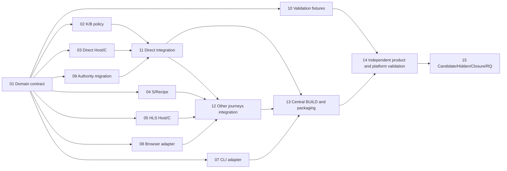

# xDownload v0.2.0 — capability-first Task DAG R0 (planning candidate, NOT FROZEN)

ISSUE=#188
STANDARD=ADS 4.18.0@2c395c55569fe2edf3f4135f12d3d069e526d0b7
PRODUCT_R0=docs/planning/v0.2.0/PRODUCT_R0.md (NOT_FROZEN)
L2_R0=docs/architecture/v0.2.0/L2_R0.md (NOT_FROZEN)
SCAFFOLD=docs/planning/v0.2.0/SCAFFOLD_R0.md (SOURCE_HOLD)
FUTURE_INTEGRATION=version/v0.2.0 (NOT_CREATED)
SOURCE_BASE=version/v0.1.0@195355d03b847825ce5acf78c73e06f7386e11e2 (historical research anchor)
LIVE_DAG=NATIVE_ISSUE_DEPENDENCIES_NOT_MATERIALIZED
DISPATCH=NONE
REVIEW_POLICY=selected per Task below
STATUS=REVIEW_CANDIDATE_ONLY

## Authority / admission
Product and L2 must first be independently reviewed and owner-frozen; critical L2 UNKNOWN U01/U02/U03 require #183 real executable evidence or lawful Architecture disposition. Freeze here is NOT authorized merely by presence of a DAG. The source-first Scaffold is a proposed structure only; no accepted immutable SF checkpoint exists, so v4.12 SF↔DF pairing is NOT_APPLICABLE until legal SF source acceptance.

The repo already contains the v0.1 codebase. No new blank repo and no second transport/Kernel. This DAG is for **v0.2 migration** after a qualified v0.1 baseline; old v0.1 release gates and Task IDs remain untouched. Do not report model speedup/CI/resource metrics not measured.

## Readable graph

## Coherent concern → Task mapping

Each row is a **proposed Task Pack** (content in `TASK_PACKS_R0.md`); Issue numbers will be bound only after reviewed DAG Freeze and native materialization. Risk H=high, M=medium. Independent Review is required where authority/API/migration/security is changed.

| Task | Issue | Lane | Depends on | Parallel | Risk | Output / accepted purpose | Executor fit | Validation | Review | Baseline | State |
| --- | --- | --- | --- | --- | --- | --- | --- | --- | --- | --- | --- |
| T01 | TBD | contract | — | NO | H | typed confirmed intent, K/C Operation identities and no-widening contract | strong contract Builder / local Node24 | schema + negative tests | required | JIT independent | TODO |
| T02 | TBD | business | T01 | YES | H | selected B/K admission, truthful result and permit | strong domain Builder | selected public SDK + fail-closed tests | required | JIT independent | TODO |
| T03 | TBD | direct-host | T01 | YES | H | existing DirectHttpAdapter via trusted C/Host, budget and digest | Node24/Windows Host Builder | real request/permit/no-network negatives | required | JIT independent | TODO |
| T04 | TBD | semantic | T01 | YES | M | existing discovery/recipe/selection as S, zero LLM path | domain/recipe Builder | finite scope and advisory negatives | recommended | JIT independent | TODO |
| T05 | TBD | media-host | T01 | YES | H | HLS existing transport selected C, no new media stack | media/Host Builder | HLS existing fixtures and bounded auth | required | JIT independent | TODO |
| T06 | TBD | cli | T01 | YES | M | thin CLI commands/query/status, no autonomous authority | TS CLI Builder | CLI reachability and status truth | recommended | JIT independent | TODO |
| T07 | TBD | browser | T01 | YES | H | existing extension/native Host bridge to App façade | Windows/browser Builder | real browser/auth/permission tests | required | JIT independent | TODO |
| T08 | TBD | migration | T01 | YES | H | unique owner old Core vs K, durable replay/recovery/rollback | concurrency/storage Builder | crash/UNKNOWN/tamper/dual writer negatives | required | JIT independent | TODO |
| T09 | TBD | validation-harness | T01 | YES | M | independent corpus/fixture/oracle and parity baseline | Validator/CI Builder | clean fixtures, no fake success | recommended | JIT independent | TODO |
| T10 | TBD | integration-direct | T02,T03,T08 | NO | H | S1 end-to-end K→C/Host→file→truth, single integration owner | senior integration Builder | actual bytes/terminal/cancel/restart | required | JIT integrated | TODO |
| T11 | TBD | integration-other | T04,T05,T07,T10 | NO | H | S2–S6 required released-path adaptation and finite collections | senior integration Builder | installed journeys and regressions | required | JIT integrated | TODO |
| T12 | TBD | build-packaging | T06,T10,T11 | NO | H | one manifest/lockfile/root BUILD owner, CLI/browser packaged join | Node24/Woodpecker/Windows Builder | clean packed SDK/Host and platform smoke | required | JIT integrated | TODO |
| T13 | TBD | validation | T09,T12 | NO | H | independent exact-candidate Windows/core/browser/critical journeys | independent Validators | actual Node24/Windows; G0/G1 parity if applicable | not-required | exact candidate | TODO |
| T14 | TBD | closure-release | T13 | NO | H | ADS Candidate Freeze → Hidden → Closure → RQ → authorized main integration | independent Release/Integration Controllers | ADS version gates, source/provenance | as required by release | exact candidate | TODO |

**Fourteen coherent Tasks:** no extra overlapping facade Task was invented. The K/B policy, migration/recovery and integration concerns have distinct owners.

## Maximum safe parallelism

After T01 genuinely merges and its contract is frozen, T02, T03, T04, T05, T06, T07, T08 and T09 have **eight distinct source ownership concerns**; up to 8 safe workfronts is the *graph-theoretical* width, not a guaranteed executor capacity or time saving. The essential joins are T10 for the direct path and T11 for non-direct. CLI can finish independently, and T09 fixtures are prepared without waiting for functional integration. T12 is the **single** root/package-lock/manifest/exports writer to avoid repeated merge conflicts.

| Lane | Exclusive planned write set | Can work with | Join |
| --- | --- | --- | --- |
| contract T01 | packages/download-domain-app/src/contracts/** and approved additive contract DTO | none until frozen interface | T02–T09 |
| business T02 | packages/download-domain-app/src/business/** | T03/T04/T05/T06/T07/T08/T09 | T10 |
| direct-host T03 | packages/download-domain-host/src/direct/** | T02/T04/T05/T06/T07/T08/T09 | T10 |
| semantic T04 | packages/download-domain-app/src/semantic/** | other independent lanes | T11 |
| media-host T05 | packages/download-domain-host/src/media/** | other independent lanes | T11 |
| cli T06 | apps/cli/src/domain-app-*.ts (authorized exact file list at JIT) | other independent lanes | T12 |
| browser T07 | apps/browser-extension/src/domain-app/** | other independent lanes | T11 |
| migration T08 | packages/download-domain-app/src/migration/** | other independent lanes | T10 |
| tests T09 | tests/domain-app/** | implementation lanes | T13 |
| direct integration T10 | packages/download-domain-app/src/composition/** | T04/T05/T06/T07/T09 | T11, T12 |
| other integration T11 | packages/download-domain-app/src/integrations/** | T06/T09 | T12 |
| single-writer central T12 | package manifests, lockfile, build/** and public index | none on these paths | T13 |

Existing `packages/core-scheduler`, `packages/persistence-ledger`, `packages/direct-acquisition` and `packages/hls-vod-adapter` are **read-only** for this migration unless a separately reviewed explicit Task DAG amendment assigns narrow writes. Host performance and past security fixes must be reused.

## Capability-first coverage

| Product acceptance | Tasks / reason |
| --- | --- |
| P01 correct target and digest | T01/T03/T10/T13 |
| P02 honest K state & UNKNOWN | T02/T08/T10/T13 |
| P03 finite collection/selection | T04/T07/T11/T13 |
| P04 restart/cancel/recovery | T08/T10/T13 |
| P05 installed parity S1–S6 | T06/T07/T11/T12/T13 |
| P06 deterministic without model | T02/T04/T09/T13 |
| P07 least authority | T02/T03/T07/T08/T13 |
| P08 measured performance/cost | T09 baseline/T13 comparison |
| P09 SDK v0.10.3 exact package | T10/T12/T13 |

## Alternative topology assessment

| Candidate | Safe independent frontiers | Shared writer/overhead | Decision |
| --- | --- | --- | --- |
| Old serial Contract→K→Host→S→UI→test | at most 1 | unnecessarily delays validation/CI/UI | REJECT |
| Split every file/negative test as separate Issue | large apparent width, overlapping authority | excessive handoffs, review and integration | REJECT |
| **Atomic contract + 8 independent lanes + two real joins + one packaging owner** | 8 after T01 | explicit T10/T11/T12 convergence, no competing ledger | SELECT candidate pending Review |
| T01 followed by simultaneous B and integration before trusted C/Host seam | unsafe overlap | false permission/fixture integration | REJECT |

## Agent suitability and role discipline

- Contract, K/B, journal/recovery, Host security: high-reasoning local Codex/Claude/other Builder, F1 bounded implementation; independent fresh Reviewer required. Actual selected Agent depends on Task claim and host capability, not model branding.
- S/Recipe, CLI and test fixture tasks can use separate builders concurrently after T01, with risk-based Review as table.
- Windows browser/native Host and packed Node24 consumers: physical local/CI executor; do not fake with static source or mock K. Human enters only for policy/consent and physical setup not automatable by CI.
- WEB does source planning/contract read/remote evidence and JIT reconciliation; only capability-excluded work gets local handoff under ADS #1241.
- Every Task needs actual accepted JIT Claim and exact base; none exists now.

## Future Stage 2.5 materialization / SF↔DF

- Task Issues and native `blocked_by` require materialization and readback after independent DAG Freeze. This tool session cannot create native dependency edges: `NATIVE_DAG_NOT_PROVEN` until a capable controller handles it. Creating Markdown or sub-issues cannot substitute.
- When an accepted source-first Scaffold exists, recompute material Git file modes/tree and bind SF anchor→Task and Task→anchor to the *real* Task Issue number and write set in a separate DF/MI pair freeze record, avoiding self-hashing.
- This candidate intentionally supplies Task IDs but **not** fake Issue numbers/commits, effective Claims or frozen Product/L2 identities.
- JIT builds use version/v0.2.0 after qualified v0.1 baseline, not this preliminary planning branch's research SHA. No implementation PRs now.

TASK_DAG_R0_COMPLETED=YES
TASK_DAG_FREEZE=NO
NATIVE_TASK_DAG=NOT_MATERIALIZED
IMPLEMENTATION_READY=NO
