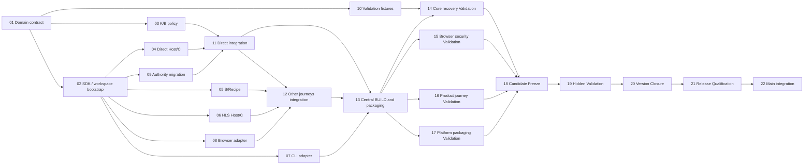

# xDownload v0.2.0 — capability-first Task DAG R0 (planning candidate, NOT FROZEN)

ISSUE=#188
STANDARD=ADS 4.18.0@2c395c55569fe2edf3f4135f12d3d069e526d0b7
PRODUCT_R0=docs/planning/v0.2.0/PRODUCT_R0.md (NOT_FROZEN)
L2_R0=docs/architecture/v0.2.0/L2_R0.md (NOT_FROZEN)
SCAFFOLD=docs/planning/v0.2.0/SCAFFOLD_R0.md (SOURCE_HOLD)
FUTURE_INTEGRATION=version/v0.2.0 (NOT_CREATED)
SOURCE_BASE=version/v0.1.0@195355d03b847825ce5acf78c73e06f7386e11e2 (historical research anchor)
LIVE_DAG=NATIVE_ISSUE_DEPENDENCIES_NOT_MATERIALIZED
DISPATCH=NONE
REVIEW_POLICY=selected per Task below
STATUS=REVIEW_CANDIDATE_ONLY

## Authority / admission
Product and L2 must first be independently reviewed and owner-frozen; critical L2 UNKNOWN U01/U02/U03 require #183 real executable evidence or lawful Architecture disposition. Freeze here is NOT authorized merely by presence of a DAG. The source-first Scaffold is a proposed structure only; no accepted immutable SF checkpoint exists, so v4.12 SF↔DF pairing is NOT_APPLICABLE until legal SF source acceptance.

The repo already contains the v0.1 codebase. No new blank repo and no second transport/Kernel. This DAG is for **v0.2 migration** after a qualified v0.1 baseline; old v0.1 release gates and Task IDs remain untouched. Do not report model speedup/CI/resource metrics not measured.

## Readable graph

## Coherent concern → Task mapping

Each row is a **proposed Task Pack** (content in `TASK_PACKS_R0.md`); Issue numbers will be bound only after reviewed DAG Freeze and native materialization. Risk H=high, M=medium. Independent Review is required where authority/API/migration/security is changed.

| Task | Issue | Lane | Depends on | Parallel | Risk | Output / accepted purpose | Executor fit | Validation | Review | Baseline | State |
| --- | --- | --- | --- | --- | --- | --- | --- | --- | --- | --- | --- |
| T01 | TBD | contract | — | NO | H | typed confirmed intent, K/C Operation identities and no-widening contract | strong contract Builder / local Node24 | schema + negative tests | required | JIT independent | TODO |
| T02 | TBD | sdk-bootstrap | T01 | NO | H | create minimal two package manifests, exact v0.10.3 candidate SDK dependencies and reproducible Node24 clean-consumer workspace | Node24 pnpm/SDK Builder | clean import/compile/pack verification, package and lockfile diff proof | required | JIT independent | TODO |
| T03 | TBD | business | T02 | YES | H | selected B/K admission, truthful result and permit | strong domain Builder | selected public SDK + fail-closed tests | required | JIT independent | TODO |
| T04 | TBD | direct-host | T02 | YES | H | existing DirectHttpAdapter via trusted C/Host, budget and digest | Node24/Windows Host Builder | real request/permit/no-network negatives | required | JIT independent | TODO |
| T05 | TBD | semantic | T02 | YES | M | existing discovery/recipe/selection as S, zero LLM path | domain/recipe Builder | finite scope and advisory negatives | recommended | JIT independent | TODO |
| T06 | TBD | media-host | T02 | YES | H | HLS existing transport selected C, no new media stack | media/Host Builder | HLS existing fixtures and bounded auth | required | JIT independent | TODO |
| T07 | TBD | cli | T02 | YES | M | thin CLI commands/query/status, no autonomous authority | TS CLI Builder | CLI reachability and status truth | recommended | JIT independent | TODO |
| T08 | TBD | browser | T02 | YES | H | existing extension/native Host bridge to App façade | Windows/browser Builder | real browser/auth/permission tests | required | JIT independent | TODO |
| T09 | TBD | migration | T02 | YES | H | unique owner old Core vs K, durable replay/recovery/rollback | concurrency/storage Builder | crash/UNKNOWN/tamper/dual writer negatives | required | JIT independent | TODO |
| T10 | TBD | validation-harness | T01 | YES | M | independent corpus/fixture/oracle and parity baseline | Validator/CI Builder | clean fixtures, no fake success | recommended | JIT independent | TODO |
| T11 | TBD | integration-direct | T03,T04,T09 | NO | H | S1 end-to-end K→C/Host→file→truth, single integration owner | senior integration Builder | actual bytes/terminal/cancel/restart | required | JIT integrated | TODO |
| T12 | TBD | integration-other | T05,T06,T08,T11 | NO | H | S2–S6 required released-path adaptation and finite collections | senior integration Builder | installed journeys and regressions | required | JIT integrated | TODO |
| T13 | TBD | build-packaging | T07,T11,T12 | NO | H | one manifest/lockfile/root BUILD owner, CLI/browser packaged join | Node24/Woodpecker/Windows Builder | clean packed SDK/Host and platform smoke | required | JIT integrated | TODO |
| T14 | TBD | validation-core | T10,T13 | YES | H | crash/restart/UNKNOWN, ledger and file-integrity exact-candidate Validation | independent core Validator | real Node24/Windows data and replay evidence | not-required | exact candidate | TODO |
| T15 | TBD | validation-browser | T13 | YES | H | browser/native Host/auth and scope/security exact-candidate Validation | independent browser Validator | real Chromium + Windows Host/permissions | not-required | exact candidate | TODO |
| T16 | TBD | validation-product | T13 | YES | H | installed S1–S6 journeys and Product G0/G1 parity if applicable | independent product Validator | real user path, oracle/effort evidence | not-required | exact candidate | TODO |
| T17 | TBD | validation-platform | T13 | YES | H | clean packed SDK, Windows/platform package qualification | independent platform Validator | exact package hashes/Node24 and installed package | not-required | exact candidate | TODO |
| T18 | TBD | candidate-freeze | T14,T15,T16,T17 | NO | H | one exact-candidate visible validation reconciliation and Freeze | Candidate Freeze Controller | all required visible gates current on same SHA | not-required | exact candidate | TODO |
| T19 | TBD | hidden-validation | T18 | NO | H | post-freeze independent Hidden Validation | independent Hidden Validator | frozen candidate/pack/environment identity | not-required | frozen candidate | TODO |
| T20 | TBD | version-closure | T19 | NO | H | validated version closure and provenance/currentness | Closure Controller | complete evidence and acceptance ledger | not-required | frozen candidate | TODO |
| T21 | TBD | release-qualification | T20 | NO | H | independent READY/CONDITIONAL/BLOCKED/FAIL release verdict | independent Release Controller | exact qualified candidate and actual RQ | not-required | frozen candidate | TODO |
| T22 | TBD | main-integration | T21 | NO | H | qualified version PR and main integration only when READY | Repository Integration Controller | exact diff, branch protection/merge identity | required | current qualified version | TODO |

**Twenty-two coherent Tasks:** 13 contract/bootstrap/concern/packaging Tasks, four independent validation concerns, and five distinct Candidate/Hidden/Closure/RQ/Repository authority Tasks. No overlapping façade Task was invented; the required ADS release authorities are not hidden in one oversized Task.

## Maximum safe parallelism

After the T01 contract and T02 minimal SDK/workspace bootstrap both merge, T03–T09 may start on seven distinct SDK-dependent concerns, while independent T10 fixture preparation can begin from T01. Together the eight concerns constitute up to **eight safe source workfronts**; up to 8 safe workfronts is the *graph-theoretical* width, not a guaranteed executor capacity or time saving. The essential joins are T11 for the direct path and T12 for non-direct. CLI can finish independently, and T10 fixtures are prepared without waiting for functional integration. After T13, T14–T17 can validate distinct physical/quality concerns against one exact candidate in parallel; T18–T22 are intentionally sequential authority gates. T02 is the initial manifest/SDK bootstrap writer. Only after T02 is completed and integrated may T13 become the **final central writer** for those same manifest/lockfile paths; this is a time-ordered single-writer handoff, not concurrent ownership. T13 also exclusively owns BUILD/exports. Both stages require exact source/readback and a distinct Claim.

| Lane | Exclusive planned write set | Can work with | Join |
| --- | --- | --- | --- |
| contract T01 | packages/download-domain-app/src/contracts/** and approved additive contract DTO | independent T10 fixture preparation after T01 | T02–T10 |
| sdk-bootstrap T02 | packages/download-domain-app/package.json, packages/download-domain-host/package.json, minimal root package.json and pnpm-lock.yaml changes if required | single writer; superseded by final T13 after merge, never concurrent | T03–T09, T13 |
| business T03 | packages/download-domain-app/src/business/** | T04/T05/T06/T07/T08/T09/T10 | T11 |
| direct-host T04 | packages/download-domain-host/src/direct/** | T03/T05/T06/T07/T08/T09/T10 | T11 |
| semantic T05 | packages/download-domain-app/src/semantic/** | other independent lanes | T12 |
| media-host T06 | packages/download-domain-host/src/media/** | other independent lanes | T12 |
| cli T07 | apps/cli/src/domain-app-*.ts (authorized exact file list at JIT) | other independent lanes | T13 |
| browser T08 | apps/browser-extension/src/domain-app/** | other independent lanes | T12 |
| migration T09 | packages/download-domain-app/src/migration/** | other independent lanes | T11 |
| tests T10 | tests/domain-app/** | implementation lanes | T14–T17 |
| direct integration T11 | packages/download-domain-app/src/composition/** | T05/T06/T07/T08/T10 | T12, T13 |
| other integration T12 | packages/download-domain-app/src/integrations/** | T07/T10 | T13 |
| final central T13 | post-T02 manifest and lockfile updates (only if needed), build/** and public index | only AFTER T02 integrated; sequential manifest write-set transfer | T14–T17 |

Existing `packages/core-scheduler`, `packages/persistence-ledger`, `packages/direct-acquisition` and `packages/hls-vod-adapter` are **read-only** for this migration unless a separately reviewed explicit Task DAG amendment assigns narrow writes. Host performance and past security fixes must be reused.

## Capability-first coverage

| Product acceptance | Tasks / reason |
| --- | --- |
| P01 correct target and digest | T01/T04/T11/T14–T17 |
| P02 honest K state & UNKNOWN | T03/T09/T11/T14–T17 |
| P03 finite collection/selection | T05/T08/T12/T14–T17 |
| P04 restart/cancel/recovery | T09/T11/T14–T17 |
| P05 installed parity S1–S6 | T07/T08/T12/T13/T14–T17 |
| P06 deterministic without model | T03/T05/T10/T14–T17 |
| P07 least authority | T03/T04/T08/T09/T14–T17 |
| P08 measured performance/cost | T10 baseline/T14–T17 comparison |
| P09 SDK v0.10.3 exact package | T11/T13/T14–T17 |

## Package manifest ownership handoff (R1 P1-01 corrective design)

- **T01** owns the typed domain contract and no runtime/production manifest; its bounded standalone contract review may rely on existing root TS tooling.
- **T02** owns ONLY the initial `packages/download-domain-app/package.json`, `packages/download-domain-host/package.json`, and minimal root `package.json`/`pnpm-lock.yaml` changes actually required. Its acceptance requires a real selected candidate v0.10.3 public package identity, Node24 clean install, reproducible module import and a negative no-silent-version-fallback result. It must NOT create a custom installer, change production transport, or claim that release v0.10.3 is published.
- **T03–T09** use the *merged T02* package roots and SDK install; without T02 readback/accepted Claim these Tasks are not source-ready. **T10** can independently prepare pure fixtures and oracles after T01, but cannot certify production runtime before T13.
- **T13** later takes exclusive write ownership of both manifests/root lock after T02 is completed and its package baseline is integrated, and owns public index/BUILD wiring. It cannot concurrently write T02 paths; it performs only necessary final dependency wiring and validates package/lock consistency. Task Packs and Task Issue write scopes must explicitly name this sequential transfer, and actual JIT Claims must not overlap.
- No accepted source-first SF currently exists, so this is planned succession, not a claim of source authority or an active SF↔DF binding. Freeze/pair integrity must use actual final Git objects and effective current writer.

## Alternative topology assessment

| Candidate | Safe independent frontiers | Shared writer/overhead | Decision |
| --- | --- | --- | --- |
| Old serial Contract→K→Host→S→UI→test | at most 1 | unnecessarily delays validation/CI/UI | REJECT |
| Split every file/negative test as separate Issue | large apparent width, overlapping authority | excessive handoffs, review and integration | REJECT |
| **Atomic contract + early SDK/package bootstrap + 8 independent lanes + two joins + late packaging handoff** | 7 SDK-dependent lanes after T02; independent fixtures after T01 | T02 initial package writer then T13 later, explicit T11/T12 convergence, no competing ledger | SELECT candidate pending Review |
| T01 followed by simultaneous B and integration before trusted C/Host seam | unsafe overlap | false permission/fixture integration | REJECT |

## Agent suitability and role discipline

- Contract, K/B, journal/recovery, Host security: high-reasoning local Codex/Claude/other Builder, F1 bounded implementation; independent fresh Reviewer required. Actual selected Agent depends on Task claim and host capability, not model branding.
- S/Recipe and CLI tasks can use separate builders after T02; fixture preparation can begin after T01, with risk-based Review as table.
- Windows browser/native Host and packed Node24 consumers: physical local/CI executor; do not fake with static source or mock K. Human enters only for policy/consent and physical setup not automatable by CI.
- WEB does source planning/contract read/remote evidence and JIT reconciliation; only capability-excluded work gets local handoff under ADS #1241.
- Every Task needs actual accepted JIT Claim and exact base; none exists now.

## Future Stage 2.5 materialization / SF↔DF

- Task Issues and native `blocked_by` require materialization and readback after independent DAG Freeze. This tool session cannot create native dependency edges: `NATIVE_DAG_NOT_PROVEN` until a capable controller handles it. Creating Markdown or sub-issues cannot substitute.
- When an accepted source-first Scaffold exists, recompute material Git file modes/tree and bind SF anchor→Task and Task→anchor to the *real* Task Issue number and write set in a separate DF/MI pair freeze record, avoiding self-hashing.
- This candidate intentionally supplies Task IDs but **not** fake Issue numbers/commits, effective Claims or frozen Product/L2 identities.
- JIT builds use version/v0.2.0 after qualified v0.1 baseline, not this preliminary planning branch's research SHA. No implementation PRs now.

TASK_DAG_R0_COMPLETED=YES
TASK_DAG_FREEZE=NO
NATIVE_TASK_DAG=NOT_MATERIALIZED
IMPLEMENTATION_READY=NO
