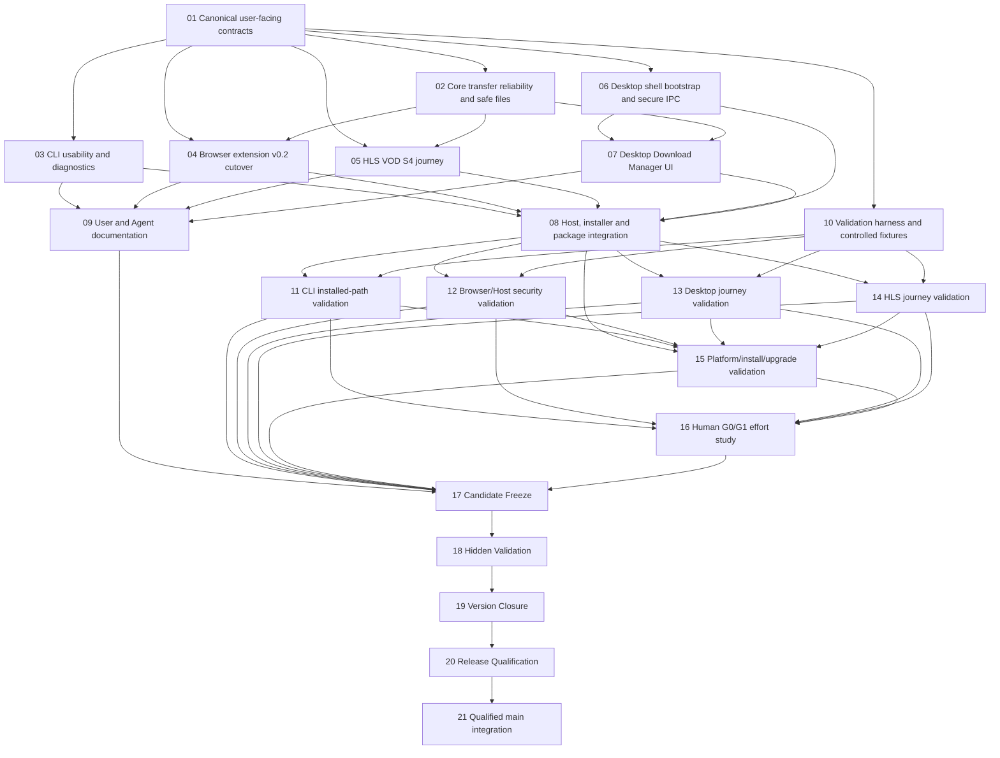

# xDownload v0.2.1 — Task DAG R0 candidate

```yaml
status: CANDIDATE_NOT_FROZEN
planning_issue: 248
product: docs/planning/v0.2.1/PRODUCT_R0.md
l2: docs/architecture/v0.2.1/L2_R0.md
baseline: main@c29af4a4b89123997d03d5566ebe09ba83855fb0
ads: 4.18.0@2c395c55569fe2edf3f4135f12d3d069e526d0b7
task_count: 21
issue_materialization: NOT_STARTED
source_dispatch: NONE
```

## 1. Planning rules

- This is a proposed DAG, not frozen authority. Product and L2 must pass independent exact-SHA review and explicit freeze first.
- The v0.2.0 frozen DAG and historical Task Packs are immutable. v0.2.1 is a successor plan, not an edit to v0.2.0.
- Materialize Task Issues and native `blocked_by` only after the DAG is reviewed/frozen. A task row or `state:planned` label is not a Claim.
- Every source Builder requires a current accepted JIT `DISPATCH_CLAIMED` against the exact integration base and Task Pack blob before source writes.
- Use exclusive source write sets. Do not let multiple lanes modify root manifests/lockfile, shared runtime state or the same package at once.
- Builder PASS, CI PASS, freeze, hidden validation, closure, RQ and merge are distinct authority decisions.

## 2. DAG graph



## 3. Task table

| ID | Lane | Depends on | Exclusive owned write set | Risk / Review | Required output |
|---|---|---|---|---|---|
| T01 | contracts | — | `packages/domain-contracts/src/**` plus contract-owned tests only | High / required | Stable job/progress/error/attempt projection contracts; explicit UNKNOWN and no-scope-widening rules |
| T02 | transfer-reliability | T01 | `packages/direct-acquisition/src/**` and its tests only | Critical / required | Bounded transient retry, safe partial-file identity/resume policy, filename/path safety, atomic finalize and collision behavior |
| T03 | CLI-UX | T01 | `apps/cli/**` | High / required | Human-readable mode, preserved JSON contract, progress on stderr, diagnostics, stable exit codes and usage |
| T04 | browser-cutover | T01,T02 | `apps/browser-extension/**` | Critical / required | v0.2 submission path, explicit permission UX, truthful status/result, fail-closed negatives |
| T05 | HLS-S4 | T01,T02 | `packages/hls-vod-adapter/**; packages/download-domain-app/src/hls/**` | High / required | Integrated bounded HLS VOD journey through selected K/Host, no parallel authority |
| T06 | desktop-shell | T01 | `apps/desktop-shell/package.json; apps/desktop-shell/src/main/**; apps/desktop-shell/src/preload/**; root package.json; pnpm-workspace.yaml; pnpm-lock.yaml` | Critical / required | Packaged local Electron shell, secure IPC/preload, pinned dependencies, no remote privileged renderer |
| T07 | desktop-UX | T01,T06,T02 | `apps/desktop-shell/src/renderer/**` | High / required | Add URL, queue/status/progress, cancel, eligible retry, destination selection, clear errors, reveal completed file |
| T08 | host-packaging | T03,T04,T05,T06,T07 | `build/**; installers/**; scripts/install-host/**` | Critical / required | Reproducible package/installer, native Host registration, exact version/build identity and clean uninstall/upgrade behavior |
| T09 | docs | T03,T04,T05,T07 | `docs/user/**; docs/agent/**` | Medium / recommended | Chinese-first user quick-start/troubleshooting; English-first Agent/automation contract; supported matrix and known limits |
| T10 | validation-harness | T01 | `tests/v0.2.1/**` | High / required | Controlled direct/HLS fixtures, restart/cancel/UNKNOWN/duplicate/path/permission corpora and reusable real-host runner |
| T11 | cli-validation | T03,T08,T10 | `docs/validation/v0.2.1/cli/**` | High / required | Clean installed CLI, direct download, status/wait/cancel/retry, JSON/text and exit-code evidence on exact SHA |
| T12 | browser-validation | T04,T08,T10 | `docs/validation/v0.2.1/browser/**` | Critical / required | Real Chromium + packaged Host, permission denial, origin mismatch, no secret leakage, installed artifact identity |
| T13 | desktop-validation | T07,T08,T10 | `docs/validation/v0.2.1/desktop/**` | High / required | Packaged UI journey, renderer isolation, queue/status/cancel/retry, restart and destination checks |
| T14 | hls-validation | T05,T08,T10 | `docs/validation/v0.2.1/hls/**` | High / required | Real controlled HLS VOD journey, selected variant/finite scope, materialized output and failure cases |
| T15 | platform-validation | T08,T11,T12,T13,T14 | `docs/validation/v0.2.1/platform/**` | Critical / required | Exact source/package/installer/installed hashes, clean install, upgrade/uninstall and supported-platform matrix |
| T16 | human-study | T11,T12,T13,T14,T15 | `docs/validation/v0.2.1/human/**` | High / human-owned | Real G0/G1 sessions against conventional baseline; actual time, steps, errors, assistance and limitations |
| T17 | candidate-freeze | T09,T11,T12,T13,T14,T15,T16 | `docs/release/v0.2.1/candidate/**` | Critical / independent gate | One exact candidate SHA/tree; all visible gates current; no unresolved blocking P0/P1 |
| T18 | hidden-validation | T17 | `docs/release/v0.2.1/hidden/**` | Critical / independent gate | Hidden corpus and adversarial validation on frozen candidate; zero escaped release-blocking cases |
| T19 | version-closure | T18 | `docs/release/v0.2.1/closure/**` | Critical / independent gate | Evidence currentness, deferral ledger reconciliation, package/source lineage and truthful open items |
| T20 | release-qualification | T19 | `docs/release/v0.2.1/rq/**` | Critical / independent gate | Exact-SHA READY/CONDITIONAL/BLOCKED/FAIL; explicit claim set and integration permission |
| T21 | main-integration | T20 | `docs/release/v0.2.1/integration/**` and protected merge only when authorized | Critical / independent gate | Re-read RQ conditions, PR diff/base, merge and exact main readback |

## 4. Parallelism and conflict controls

- T02, T03, T05, T06 and T10 can run in parallel after T01 is accepted, subject to independent source claims and each exact write set.
- T04 waits for T02 because browser cutover must consume the stabilized transfer/identity policy.
- T07 waits for T06 and T02; it consumes the existing surface adapter and authoritative projections.
- T08 is the single owner of packaging, installer and Host registration. No other task edits `build/**`, installer manifests, or root dependency lockfiles.
- T09 is documentation-only and does not edit frozen Product/L2 semantics.
- T11–T15 are separate evidence lanes with disjoint write sets. Their evidence must bind the same exact candidate source lineage.
- T16 requires real human participants. Agents may prepare scripts and capture evidence, but cannot manufacture human results.
- T17–T21 are strictly serial authority gates.

## 5. Freeze blockers / scope discipline

Before freezing this DAG, the independent reviewer must verify: Product/L2 exact SHA and owner authority; Electron security/packaging feasibility; each source write set; no source-write overlap; all dependencies are real; graph is acyclic; platform claims are bounded; human G0/G1 ownership is explicit; S4 is not silently dropped; SDK pin is v0.10.3 Git-source only.

No Task Issues have been materialized from this candidate yet. Once Product/L2/DAG review and explicit freeze are accepted, create canonical Task Issues and native dependencies, then JIT claims. This document alone authorizes no source implementation.
