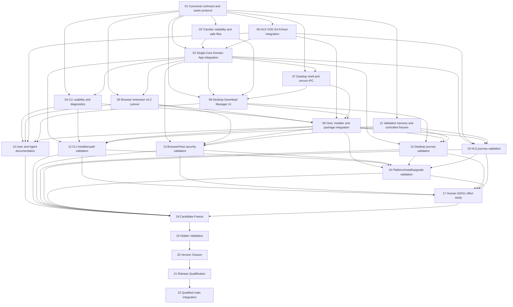

# xDownload v0.2.1 — Task DAG R0 candidate

```yaml
status: CANDIDATE_NOT_FROZEN
planning_issue: 248
product: docs/planning/v0.2.1/PRODUCT_R0.md
l2: docs/architecture/v0.2.1/L2_R0.md
baseline: main@c29af4a4b89123997d03d5566ebe09ba83855fb0
ads: 4.18.0@2c395c55569fe2edf3f4135f12d3d069e526d0b7
task_count: 22
issue_materialization: NOT_STARTED
source_dispatch: NONE
```

## 1. Planning rules

- This is a proposed DAG, not frozen authority. Product and L2 must pass independent exact-SHA review and explicit freeze first.
- The v0.2.0 frozen DAG and historical Task Packs are immutable. v0.2.1 is a successor plan, not an edit to v0.2.0.
- Materialize Task Issues and native `blocked_by` only after the DAG is reviewed/frozen. A task row or `state:planned` label is not a Claim.
- Every source Builder requires a current accepted JIT `DISPATCH_CLAIMED` against the exact integration base and Task Pack blob before source writes.
- Use exclusive source write sets. Do not let multiple lanes modify root manifests/lockfile, shared runtime state or the same package at once.
- The Domain App must be integrated into the single existing Core process. CLI, Desktop and Browser must not each instantiate their own K runtime.
- Builder PASS, CI PASS, freeze, hidden validation, closure, RQ and merge are distinct authority decisions.

## 2. DAG graph



## 3. Task table

| ID | Lane | Depends on | Exclusive owned write set | Risk / Review | Required output |
|---|---|---|---|---|---|
| T01 | contracts-and-seam | — | `packages/domain-contracts/**; packages/core-seam/**` | Critical / required | Stable job/attempt/progress/error contracts; explicit v0.2 route; no-widening and unknown-owner refusal |
| T02 | single-core-integration | T01,T03,T06 | `packages/core-runtime/**; packages/converged-runtime/**` | Critical / required | Load K once in the existing Core process; route new lineages to K and old lineages to old Core; preserve one writer per lineage and restart ownership |
| T03 | transfer-reliability | T01 | `packages/direct-acquisition/**` | Critical / required | Bounded transient retry, validator-gated resume, safe partial-file identity, filename/path safety, atomic finalization and collision behavior |
| T04 | CLI-UX | T01,T02 | `apps/cli/**` | High / required | Installed argv route, stable JSON, explicit human mode/progress on stderr, diagnostics, clear errors and exit codes |
| T05 | browser-cutover | T01,T02 | `apps/browser-extension/**` | Critical / required | v0.2 submission path, explicit permission UX, truthful status/result, fail-closed negatives |
| T06 | HLS-S4-integration | T01 | `packages/download-domain-app/src/integrations/s4-hls-vod.ts; packages/download-domain-app/src/integrations/index.ts; packages/download-domain-host/src/media/**; packages/hls-vod-adapter/**` | High / required | Explicit bounded S4 HLS VOD journey through K/Host, reusing existing HLS engine; no duplicate authority or media engine |
| T07 | desktop-shell | T01,T02 | `apps/desktop-shell/package.json; apps/desktop-shell/src/main/**; apps/desktop-shell/src/preload/**; root package.json; pnpm-workspace.yaml; pnpm-lock.yaml` | Critical / required | Minimal runnable Electron shell using existing Core lifecycle/seam; typed preload, secure IPC, exact pinned runtime/dependencies |
| T08 | desktop-UX | T01,T02,T03,T07 | `apps/desktop/src/**; apps/desktop-shell/src/renderer/**` | High / required | Add URL, target/output preview, job list, truthful progress/status, cancel, eligible retry, clear failure, destination choice and reveal file |
| T09 | host-packaging | T04,T05,T06,T07,T08 | `build/**; installers/**; scripts/install-host/**` | Critical / required | Reproducible package/installer, native Host registration, exact version/build identity and safe install/upgrade/uninstall |
| T10 | docs | T04,T05,T06,T08,T09 | `docs/user/**; docs/agent/**` | Medium / recommended | Chinese-first user quick-start/troubleshooting; English-first Agent/automation contract; supported matrix and known limits |
| T11 | validation-harness | T01 | `tests/v0.2.1/**` | High / required | Controlled direct/HLS fixtures, restart/cancel/UNKNOWN/duplicate/path/permission corpora and reusable real-host runner |
| T12 | cli-validation | T02,T04,T09,T11 | `docs/validation/v0.2.1/cli/**` | High / independent required | Clean installed CLI, direct download, status/wait/cancel/retry/batch, JSON/text and exit-code evidence |
| T13 | browser-validation | T02,T05,T09,T11 | `docs/validation/v0.2.1/browser/**` | Critical / independent required | Real Chromium + packaged Host, permission denial, origin mismatch, no secret leakage, installed artifact identity |
| T14 | desktop-validation | T02,T08,T09,T11 | `docs/validation/v0.2.1/desktop/**` | High / independent required | Packaged UI journey, renderer isolation, queue/status/cancel/retry, restart and destination checks |
| T15 | hls-validation | T02,T06,T09,T11 | `docs/validation/v0.2.1/hls/**` | High / independent required | Real controlled HLS VOD journey, finite scope, materialized output and failure cases |
| T16 | platform-validation | T09,T12,T13,T14,T15 | `docs/validation/v0.2.1/platform/**` | Critical / independent required | Exact source/package/installer/installed hashes, clean install, upgrade/uninstall and supported-platform matrix |
| T17 | human-study | T12,T13,T14,T15,T16 | `docs/validation/v0.2.1/human/**` | High / human-owned | Real G0/G1 sessions against conventional baseline; actual time, steps, errors, assistance and limitations |
| T18 | candidate-freeze | T10,T12,T13,T14,T15,T16,T17 | `docs/release/v0.2.1/candidate/**` | Critical / independent gate | One immutable candidate SHA/tree; all visible gates current; no unresolved blocking P0/P1 |
| T19 | hidden-validation | T18 | `docs/release/v0.2.1/hidden/**` | Critical / independent gate | Hidden corpus and adversarial validation; zero escaped release-blocking cases |
| T20 | version-closure | T19 | `docs/release/v0.2.1/closure/**` | Critical / independent gate | Evidence currentness, deferral ledger, package/source lineage and truthful open items |
| T21 | release-qualification | T20 | `docs/release/v0.2.1/rq/**` | Critical / independent gate | Exact-SHA READY/CONDITIONAL/BLOCKED/FAIL, exact claim set and integration permission |
| T22 | main-integration | T21 | `docs/release/v0.2.1/integration/**` and protected merge only when authorized | Critical / independent gate | Re-read RQ conditions, PR diff/base, merge and exact main readback |

## 4. Parallelism and conflict controls

- T03, T06, T04, T05, T07 and T11 can progress in independent write sets after T01, except where the explicit dependencies above apply.
- T02 is the single owner of the central runtime integration. No surface task may create a second K instance or edit the core/converged runtime.
- T03 owns direct-transfer code; T06 owns the HLS Domain App/Host integration. Both are composed by T02 only after their accepted contracts exist.
- T07 owns Electron main/preload and root dependency wiring; T08 owns renderer code. T09 is the only owner of installer/Host packaging.
- T10 is docs-only. T11 owns reusable fixtures, while T12–T16 write evidence to disjoint directories and bind results to the same candidate lineage.
- T17 requires real human participants. Agents may prepare scripts and capture evidence, but cannot manufacture human results.
- T18–T22 are strictly serial authority gates.

## 5. Freeze blockers / scope discipline

Before freezing, the independent reviewer must verify: Product/L2 exact SHA and Owner authority; the single-process lineage router and no-dual-writer rule; Electron security assumptions; all 22 nodes and edges; acyclicity; non-overlapping write sets; exact supported platform matrix; explicit human G0/G1 ownership; S4 not silently dropped; and SDK provenance. The SDK gate must bind source tag commit `061376f4a023070f215f9feffad5c24d96d503cb` / tree `099cdc831aef63befd62aaede7e7a853d1be468f`, disclose that the four tarballs retain internal package version `0.10.2-rc.0`, and verify 4/4 SHA-256 against the #183 source-build receipts. Do not infer npm publication or silently rename/repack.

No Task Issues have been materialized from this candidate yet. Once Product/L2/DAG review and explicit freeze are accepted, create canonical Task Issues and native dependencies, then JIT claims. This document alone authorizes no source implementation.
